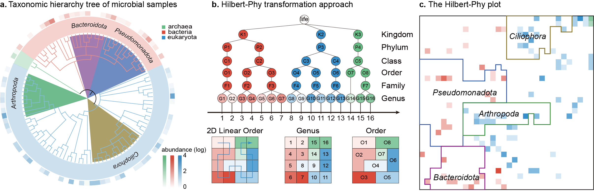

## Hilbert-Phy - A Two-Dimensional Encoding Method for Microbiome Data Analysis

Current deep learning approaches in microbiome analysis often fail to effectively incorporate inherent biological structures, such as phylogenetic relationships. Methods that attempt to integrate this hierarchy can introduce artificial constructs or require complex preprocessing. This limits their flexibility, generalizability, and ability to robustly model microbial interactions across diverse tasks.

Hilbert-Phy addresses these limitations by encoding phylogenetic relationships directly into a 2D image using a Hilbert curve. Its core advantage is the locality-preserving property, which maps evolutionarily related taxa adjacently without needing auxiliary data. This creates a biologically informed structure that allows CNNs to effectively detect local abundance patterns and potential microbial interactions. Moreover, the framework is highly flexible, readily applicable to diverse tasks like classification and longitudinal analysis without structural changes. Evaluations show it consistently outperforms prior methods across multiple benchmarks.

