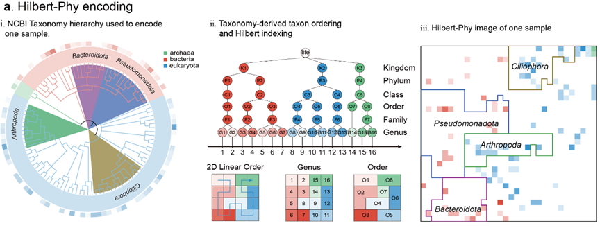

# Hilbert-Phy

**Hilbert-Phy** is a modular, phylogeny-aware encoding for microbiome taxon-abundance profiles. It uses the NCBI Taxonomy hierarchy to order taxa and a Hilbert curve to place them on a two-dimensional grid. Each taxon occupies a fixed position within a dataset, so downstream models can use the images while image positions remain traceable to taxa.



*Hilbert-Phy encoding (Figure 1a of the paper). (i) The NCBI Taxonomy hierarchy organizes taxa. (ii) A 16-genus schematic shows the taxonomy-derived order and its Hilbert-grid positions. (iii) The same mapping places one sample's normalized abundances at fixed pixel coordinates; outlined regions correspond to the highlighted taxonomic groups.*


The paper evaluates these images in biome and disease classification, longitudinal phenotype classification, and temporal microbial community generation. This repository provides a runnable encoding example and the five-level biome-classification workflow, including 13 model configurations and five-fold evaluation. 

| Component | What it contains | Data requirement |
|---|---|---|
| [`encoding_example/`](encoding_example/) | Standalone CLI and two-sample demonstration of taxonomy ordering, padding, and Hilbert encoding | NumPy inputs generated locally and an ete3 NCBI taxonomy database |
| [`biome_classification/data_processing/`](biome_classification/data_processing/) | Prepared-data import, raw-count processing, NCBI matching and ordering, Hilbert indices | Prepared `DATASET` bundle or the corresponding raw MGnify inputs |
| [`biome_classification/model_training/`](biome_classification/model_training/) | ResNet, phylogeny-aware, and classical baselines; internal evaluation and optional analyses | Prepared training data; optional analyses need additional inputs |

## Minimal encoding example

The example works on Windows and Linux with Python 3.10 or later. From the repository root:

```bash
cd encoding_example
python -m venv .venv
source .venv/bin/activate
python -m pip install -r requirements.txt
python demo.py
```

On Windows PowerShell, use `.\.venv\Scripts\Activate.ps1` instead of the `source` command. If you already have an ete3 taxonomy database, run `python demo.py --dbfile /path/to/taxa.sqlite`.

The demo generates two samples with three tax IDs, encodes them, and checks the output. To run the encoder directly, generate the inputs and call [`encode.py`](encoding_example/encode.py):

```bash
python - <<'PY'
import numpy as np

# Escherichia coli, Staphylococcus aureus, Pseudomonas aeruginosa
np.save('tax_ids.npy', np.array([562, 1280, 287], dtype=np.int64))
# Rows are samples; columns follow the tax ID order above.
np.save('abundance.npy', np.array([[1., 2., 3.], [4., 5., 6.]]))
PY

python encode.py --tax-ids tax_ids.npy --abundance abundance.npy --output encoded.npy
```

The output has shape `(2, 2, 2)`: three input values and one padded zero per sample. Check the values without assuming exact pixel coordinates:

```bash
python - <<'PY'
import numpy as np

abundance = np.load('abundance.npy', allow_pickle=False)
encoded = np.load('encoded.npy', allow_pickle=False)
assert encoded.shape == (2, 2, 2), encoded.shape
expected = np.concatenate([abundance, np.zeros((2, 1))], axis=1)
np.testing.assert_array_equal(
    np.sort(encoded.reshape(2, 4), axis=1),
    np.sort(expected, axis=1),
)
PY
```

The check preserves repeated values. Pixel coordinates can change with the taxonomy database version, so use the same database version when exact coordinates matter. Generated `.npy` files are excluded by the repository's `.gitignore`.

ete3 uses `~/.etetoolkit/taxa.sqlite` by default. On first use it may download the NCBI taxdump and build the database, which requires internet access, a writable home directory, and disk space. An existing SQLite database can be passed with `--dbfile /path/to/taxa.sqlite`; do not pass a raw taxdump archive. The example does not need PyTorch.

## Biome-classification data

`DATASET` is a local name for the prepared training-data. It is not supplied in this source directory. Raw inputs come from MGnify SSU taxonomy abundance tables and are matched to NCBI Taxonomy. The documented preparation path is:

```text
263,302 samples with labels at five biome levels
-> raw counts matched by run ID for 262,942 samples
-> terminal genus records, NCBI matching, and merging by tax ID: 10,437 genera
-> genera observed in >50 samples; top 4,096 by mean relative abundance
-> samples with >=20 detected selected genera: 238,419 samples
-> NCBI taxonomy post-order feature order and a 64x64 Hilbert index
```

Counts from species records are not additionally aggregated into training genera. Mean relative abundance uses the count total across all 10,437 matched genera as the denominator. Sibling nodes are visited in ascending numeric tax ID order. The original experiments used taxonomy dump files dated 2024-10-28 for internal nodes and names; preserve that version to reproduce the feature order.

### Import a prepared bundle

The exact file and array interface is documented at the top of [`filter_data.py`](biome_classification/data_processing/filter_data.py). The `--input` path must point to the prepared bundle's `data_processing` directory. On Linux or WSL, from the repository root:

```bash
cd biome_classification
python -m venv .venv
source .venv/bin/activate
python -m pip install -r requirements.txt
python data_processing/filter_data.py import --help
python data_processing/filter_data.py import --input /path/to/DATASET_A --check-only
python data_processing/filter_data.py import --input /path/to/DATASET_A
```

`--check-only` checks that required files exist; it does not validate their numerical contents. Importing copies the files into the local `data_processing/` tree and refuses to overwrite existing inputs. Training preparation later checks matrix dimensions, IDs, feature order, and source mappings. Add `--marine` to the import command if the marine analysis needs unpacked taxonomy files. Full classification runs use `fcntl` file locks and require Linux or WSL.

### Process raw tables instead

The three data-processing modules have distinct roles:

| File | Role |
|---|---|
| [`filter_data.py`](biome_classification/data_processing/filter_data.py) | Match raw counts by run ID, extract terminal `g__` records, select features and samples, or import `DATASET` |
| [`ncbi.py`](biome_classification/data_processing/ncbi.py) | Extract taxonomy files, match and merge genera, and produce the post-order taxon sequence |
| [`hilbert_phy.py`](biome_classification/data_processing/hilbert_phy.py) | Generate the 64×64 Hilbert permutation or encode a dense abundance array |

Place `mgnify_biomes.csv`, `raw_data/studies/*/abundance/`, and `taxdump.tar.gz` according to the input interface. If a run has several pipeline versions, the highest numeric version is used; counts from different runs are not combined. From `biome_classification/`:

```bash
python data_processing/filter_data.py match-counts
python data_processing/filter_data.py genus
python data_processing/ncbi.py extract
python data_processing/ncbi.py match
python data_processing/filter_data.py select
python data_processing/ncbi.py order
python data_processing/hilbert_phy.py indices
```

`genus` keeps records with a nonempty terminal `g__` entry and does not roll species records up to genus. `select` runs `features` and `samples`: it removes genera observed in at most 50 samples, selects the top 4,096 by mean relative abundance, then keeps samples with at least 20 detected selected genera. It does not filter biome labels by class. `order` updates the training matrix, feature table, and column mapping; do not repeat it for a prepared bundle that is already post-order. Integer counts remain unchanged during data processing. Abundance normalization happens in training.

To encode a separate dense samples-by-features array from `biome_classification/`:

```bash
# Array already ordered by taxonomy post-order:
python data_processing/hilbert_phy.py encode --input abundance.npy --output encoded.npy
# Unordered columns corresponding to tax_ids.npy:
python data_processing/hilbert_phy.py encode --input abundance.npy --tax-ids tax_ids.npy --output encoded.npy
```

Inputs must be finite and nonnegative. Encoding does not normalize or quantize them. The permutation maps row-major pixel positions to indices in the ordered vector, so the image is `padded[:, hilbert].reshape(samples, side, side)`.

## Model training and internal evaluation

The default [`run_pipeline.py`](biome_classification/run_pipeline.py) runs all five biome levels and five folds for 13 model configurations, then combines their results:

| Model family | Configurations | Entry point |
|---|---:|---|
| Hilbert and rowwise ResNet-18/34/50; 1D ResNet-18 | 7 | [`model_training/train.py`](biome_classification/model_training/train.py) |
| DeepPhylo taxonomy and PopPhy-CNN | 2 | [`phylogeny_baselines/train.py`](biome_classification/model_training/phylogeny_baselines/train.py) |
| Random forest and logistic regression, each with original/random column order | 4 | [`classical_order_control/train.py`](biome_classification/model_training/classical_order_control/train.py) |

That is `13 × 5 × 5 = 325` configuration-level-fold tasks. [`common.py`](biome_classification/model_training/common.py) handles the shared ResNet splits, normalization, training, and metrics; [`models.py`](biome_classification/model_training/models.py) defines the networks and input layouts. The tree-model baselines have their own tree construction, data transformation, and network modules. They are adaptations to the NCBI genus tree, not exact reproductions of every setting in the original methods' papers.

### Training protocol

- Each biome level is modeled separately. Empty, `NA`, and `None` labels and classes with fewer than 100 samples are excluded, so levels have different evaluation sets.
- Outer splits use `StratifiedKFold(5, shuffle=True, random_state=0)`. A stratified 20% of each outer training pool is used for validation, giving approximately 64% training, 16% validation, and 20% testing overall.
- The 4,096 genera and minimum-20-genera cohort are selected **globally before cross-validation**. Within each fold, per-genus min-max normalization is fitted only on its training samples. Constant columns are set to zero, and validation/test values are not clipped.
- Hilbert, rowwise, and 1D inputs use the same numerical values. The two-dimensional ResNets are single-channel models trained without pretrained weights.
- Neural networks use cross-entropy loss, Adam, learning rate 0.001, batch size 32, and at most 200 epochs. The best checkpoint is chosen by validation loss, with early stopping after 10 epochs without improvement.
- Outputs include accuracy, Macro-F1, and one-vs-rest Macro-AUROC. Reports give five-fold means and sample standard deviations, with pooled out-of-fold metrics listed separately.

The fixed global feature and sample selection should not be described as fold-local selection. Internal splits are by sample rather than by study, so internal scores do not by themselves establish cross-study generalization.

### Outputs

New runs write under these paths within `biome_classification/`:

```text
model_training/shared_cache/                          # splits and train-fitted normalization
model_training/results/experiments/                   # seven ResNet configurations
model_training/phylogeny_baselines/*/results/formal/   # two tree-model baselines
model_training/classical_order_control/results/       # four classical configurations
model_training/results/training_results_summary.md
model_training/results/training_fold_metrics.csv
model_training/results/training_method_level_summary.csv
```

Individual runs save their configuration, predictions, and metrics; neural-network runs also save best and latest checkpoints. Run `python model_training/results/summarize_training.py` to rebuild the summary. Completed tasks can be skipped and neural-network training can resume, but changed inputs or code signatures need new cache and result directories.

Historical aggregate tables, if distributed separately under `biome_classification/reference_results/`, describe earlier experiments and do not show that this code revision has rerun them.


### External evaluation

[`external_validation/`](biome_classification/model_training/external_validation/) performs inference with existing fold checkpoints and evaluates known labels. It requires a separately prepared local `data/` bundle with counts, labels, a feature table, and normalization denominators. Samples with missing or previously unseen labels receive predictions but do not enter closed-set metrics. From `biome_classification/`:

```bash
python model_training/external_validation/prepare.py
python model_training/external_validation/evaluate.py --device cpu --model hilbert_resnet18 hilbert_resnet34 hilbert_resnet50 rowwise_resnet18 rowwise_resnet34 rowwise_resnet50 1d_resnet18 deepphylo_taxonomy popphy_cnn random_forest_rowwise random_forest_random logistic_regression_rowwise logistic_regression_random
```

The exact input contract is implemented by [`ExternalData`](biome_classification/model_training/external_validation/foundation.py). Inference uses each trained fold's parameters without refitting. Historical external summaries, if separately supplied, do not replace the required data and checkpoints.

### Marine interpretation

[`gradcam_marine_reanalysis/`](biome_classification/model_training/gradcam_marine_reanalysis/) uses five Level 3 Hilbert-ResNet-18 models. Import the bundle with `--marine` to include unpacked taxonomy files, then run from `biome_classification/`:

```bash
python model_training/gradcam_marine_reanalysis/run.py --output model_training/gradcam_marine_reanalysis/results/formal_v1
python model_training/gradcam_marine_reanalysis/tools.py predict --output model_training/gradcam_marine_reanalysis/results/formal_v1
python model_training/gradcam_marine_reanalysis/tools.py audit --output model_training/gradcam_marine_reanalysis/results/formal_v1
python model_training/gradcam_marine_reanalysis/tools.py plot --output model_training/gradcam_marine_reanalysis/results/formal_v1
python model_training/gradcam_marine_reanalysis/tools.py report --output model_training/gradcam_marine_reanalysis/results/formal_v1
```

The analysis combines Grad-CAM, training-set abundance associations, and test-input perturbations. These outputs describe model attention and sensitivity, not ecological causation by individual genera. 
